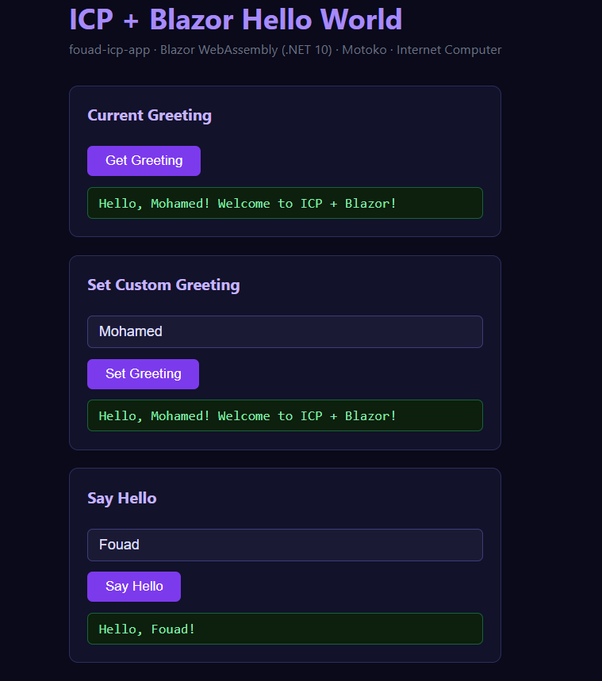

# ICP Blazor Hello World
full medium article : 
https://medium.com/@mitnick2012/your-net-blazor-skills-just-became-blockchain-skills-c41c14d87b44

A hello world template combining **Blazor WebAssembly (.NET 10)** on the frontend and **Motoko** on the backend, deployed fully on-chain on the **Internet Computer (ICP)**.

Hello World Blazor Demo App:



> Scaffold a new project with [`icp new`](https://cli.internetcomputer.org/1.0/guides/creating-templates/):
>
> ```bash
> # from the team template collection
> icp new my-app --git https://github.com/mitnick2012/icp-cli-templates --subfolder blazor-hello-world
>
> # from a published git repo containing only this template
> icp new my-app --git https://github.com/mitnick2012/icp-blazor-wasm-template
>
> # or from a local checkout (the folder with cargo-generate.toml)
> icp new my-app --path ./icp-blazor-hello
> ```
>
> `my-app` becomes the canister names `my-app-backend` / `my-app-frontend` and the
> .NET project name `MyApp`.

## Stack

| Layer    | Technology                          |
|----------|-------------------------------------|
| Frontend | Blazor WebAssembly (.NET 10)        |
| Backend  | Motoko canister                     |
| Bridge   | @icp-sdk/core (webpack bundle)      |
| Platform | Internet Computer (ICP)             |
| CLI      | icp-cli                             |

## Project Structure

```
icp-blazor-hello/
├── cargo-generate.toml               # icp-cli template config (cargo-generate)
├── icp.yaml                          # icp-cli project config
├── .gitignore
├── scripts/
│   └── fix-wsl-keyring.sh            # headless identity helper for WSL
├── backend/
│   ├── canister.yaml                 # backend canister config (name: {{ project-name }}-backend)
│   ├── backend.did                   # Candid interface (semicolons required!)
│   └── src/
│       └── main.mo                   # Motoko canister
└── frontend/
    ├── canister.yaml                 # frontend canister config (name: {{ project-name }}-frontend)
    ├── vendor/
    │   └── assetstorage.wasm.gz      # pinned asset canister WASM (no build-time download)
    └── {{ project-name }}/
        ├── {{ project-name }}.csproj # .NET 10 Blazor WASM (AssemblyName = {{ project-name | pascal_case }})
        ├── Program.cs
        ├── App.razor
        ├── _Imports.razor            # required — Blazor namespace imports
        ├── package.json              # webpack + @icp-sdk/core
        ├── webpack.config.js         # bundles icpAgent.ts → wwwroot/icpAgent.js
        ├── tsconfig.json
        ├── src/
        │   └── icpAgent.ts           # TypeScript ICP agent bridge
        ├── Layout/
        │   └── MainLayout.razor
        ├── Pages/
        │   └── Home.razor            # main UI with canister calls
        ├── Services/
        │   └── IcpAgentService.cs    # C# → JS interop service
        └── wwwroot/
            ├── index.html
            └── app.css
```

## How it works

```
Home.razor (C#)
  → IcpAgentService.cs (IJSRuntime)
    → window.IcpAgent.* (webpack bundle, defer loaded)
      → @icp-sdk/core (Agent module: https://js.icp.build/core/latest/libs/agent)
        → Motoko backend canister on ICP
```

The key insight: use **webpack** to bundle `@icp-sdk/core` into a plain JS file
loaded with `defer`, not as an ES module. This avoids the race condition between
the module loader and Blazor's JS interop system.

## Prerequisites

```bash
# icp-cli
npm install -g @icp-sdk/icp-cli @icp-sdk/ic-wasm

# Motoko toolchain
npm install -g ic-mops
```

### .NET 10 SDK

**Method 1: Ubuntu 24.04 LTS or newer (APT)**
```bash
sudo apt update
sudo apt install -y dotnet-sdk-10.0
```

> **Ubuntu 22.04 LTS?** Register the backports PPA first:
> ```bash
> sudo add-apt-repository ppa:dotnet/backports
> sudo apt update
> sudo apt install -y dotnet-sdk-10.0
> ```

**Method 2: Official Microsoft script (recommended for non-Ubuntu or if APT fails)**
```bash
wget https://dot.net/v1/dotnet-install.sh -O dotnet-install.sh
chmod +x dotnet-install.sh
./dotnet-install.sh --channel 10.0
```

After installing, add .NET to your PATH:
```bash
echo 'export PATH="$HOME/.dotnet:$PATH"' >> ~/.bashrc
source ~/.bashrc
```

### Blazor WASM workload (required)
```bash
dotnet workload install wasm-tools
```

### Remove conflicting `icp` binary (Ubuntu/Debian)
Ubuntu ships a package called `renameutils` that installs its own unrelated `icp` binary.
Remove it before installing icp-cli:
```bash
sudo apt remove renameutils -y
```

Verify the correct `icp` is active:
```bash
icp --version  # should show icp-cli, not renameutils
```

## Run locally

```bash
# 1. Start the local ICP network (gateway on the standard port 8000,
#    see icp.yaml networks.gateway.port)
icp network start -d
icp network status   # Gateway Url: http://localhost:8000/

# 2. Deploy both canisters
icp deploy

# 3. Open the frontend URL printed by icp deploy (friendly domain), e.g.
#    {{ project-name }}-frontend: http://{{ project-name }}-frontend.local.localhost:8000/
#    The canister-id form works too: http://<frontend-canister-id>.localhost:8000/
```

## Deploy to mainnet

```bash
icp deploy --network ic
```

## License

MIT
